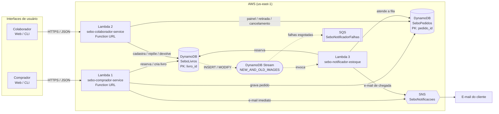
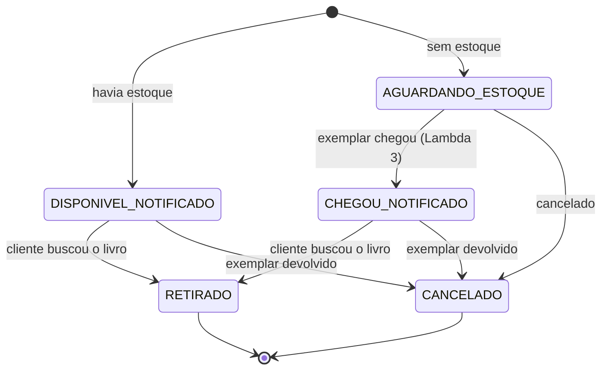
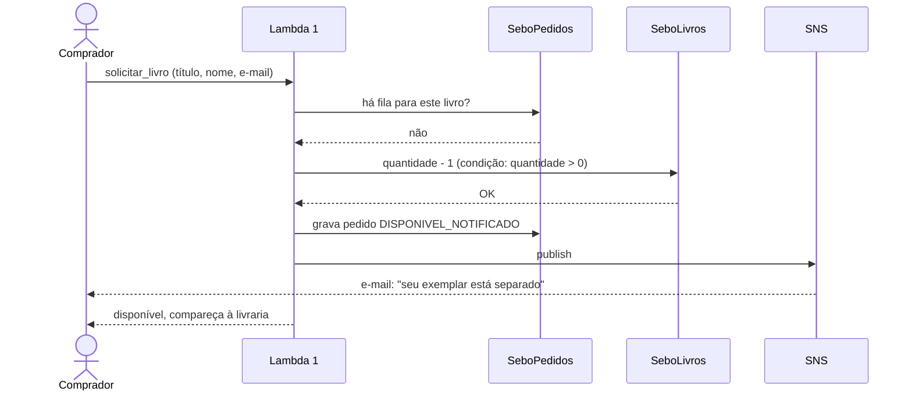
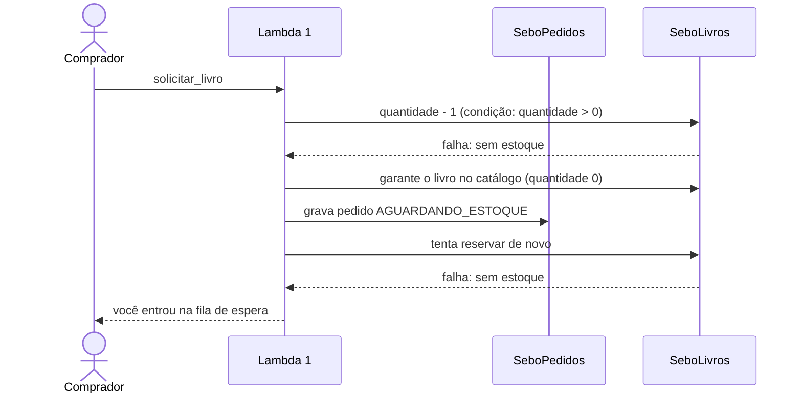
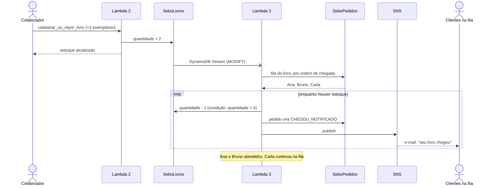
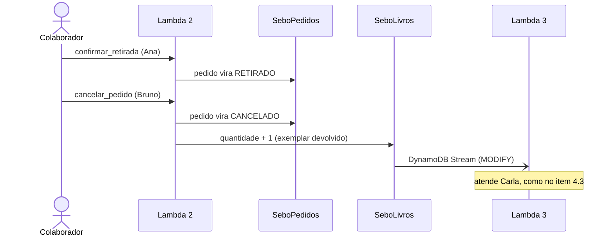

# Sebo Serverless na AWS

Trabalho 2 de INF1304 - Distribuição e Concorrência (PUC-Rio), 2026/2
Integrantes: João Pedro Paiva e Hugo Freire

Aplicação de um sebo na AWS com três funções Lambda, duas tabelas DynamoDB e envio de e-mail pelo SNS.

- **Livro em estoque:** o exemplar é separado na hora e o comprador recebe um e-mail para buscá-lo na loja.
- **Livro sem estoque:** o pedido entra numa fila de espera.
- **Chegada de exemplares:** quando o colaborador registra a entrada do livro, a fila é atendida automaticamente, em ordem de chegada, e cada cliente atendido recebe um e-mail.

## 1. O que foi implementado

| Requisito | Implementação |
| :--- | :--- |
| 3 funções Lambda | `sebo-comprador-service`, `sebo-colaborador-service`, `sebo-notificador-estoque` |
| Banco de dados | DynamoDB: `SeboLivros` (catálogo e estoque) e `SeboPedidos` (vendas e fila de espera) |
| E-mail via SNS | Tópico `SeboNotificacoes` |
| Interface do comprador | Aba "Comprador" de `interfaces/web/index.html` e `interfaces/cli_comprador.py` |
| Interface do colaborador | Aba "Colaborador" de `interfaces/web/index.html` e `interfaces/cli_colaborador.py` |

Além do pedido no enunciado:
- O colaborador **confirma a retirada** do livro na loja ou **cancela** o pedido. Um cancelamento devolve o exemplar ao estoque, e o próximo da fila é avisado.
- **Fila justa:** quem pede depois não fica com o exemplar se já há gente aguardando.
- Eventos que falham na Lambda 3 são **reprocessados** e, se continuarem falhando, vão para uma fila SQS de falhas.
- `scripts/setup_aws.py` cria toda a infraestrutura; `scripts/test_fluxos.py` testa os fluxos.

## 2. Arquitetura



- **Lambda 1 (comprador):** lista o acervo, recebe o pedido (reserva imediata ou fila de espera) e consulta os pedidos de um e-mail. Envia o e-mail imediato.
- **Lambda 2 (colaborador):** cadastra e repõe livros, mostra o painel de estoque, vendas e fila, e confirma retiradas ou cancela pedidos. **Não envia e-mails**: só grava no banco.
- **Lambda 3 (notificador):** acionada pelo DynamoDB Stream de `SeboLivros`. Quando um livro passa a ter estoque, atende a fila daquele livro e envia os e-mails de chegada.

A Lambda 2 e a Lambda 3 se comunicam só pelo Stream, sem uma chamar a outra. O colaborador recebe a resposta sem esperar a fila ser atendida (desacoplamento no tempo), e a Lambda 2 não sabe que a Lambda 3 existe (desacoplamento no espaço).

## 3. Dados

**`SeboLivros`** (PK `livro_id`, ex: `dom-casmurro`): `titulo`, `autor`, `preco`, `quantidade` (exemplares livres), `total_vendidos`, `atualizado_em`.

**`SeboPedidos`** (PK `pedido_id`): `livro_id`, `titulo`, `comprador_nome`, `comprador_email`, `status`, `criado_em` (define a ordem da fila), `notificado_em`, `observacao`.

Ciclo de vida de um pedido:



## 4. Diagramas de sequência

### 4.1. Livro em estoque



### 4.2. Livro sem estoque



A segunda tentativa cobre o caso de um exemplar chegar enquanto o pedido estava sendo gravado. Se ela conseguir, o pedido vira `DISPONIVEL_NOTIFICADO` e o e-mail sai na hora.

### 4.3. Chegada do livro e aviso automático



### 4.4. Retirada e cancelamento



## 5. Concorrência

Várias execuções das Lambdas podem rodar ao mesmo tempo, por exemplo dois compradores pedindo o último exemplar, ou a Lambda 1 e a Lambda 3 disputando o mesmo exemplar. A consistência é garantida sem locks:

1. **Estoque sem condição de corrida.** Ler a quantidade e depois gravar o novo valor deixaria dois clientes levarem o mesmo exemplar (*lost update*). Por isso, toda baixa é um único `update_item` com `ConditionExpression="quantidade > :zero"`. O DynamoDB testa a condição e grava de forma atômica: só uma das requisições passa, e a outra recebe `ConditionalCheckFailedException`.
2. **Pedido atendido uma vez só.** Mudar o status de um pedido também exige o status anterior certo (ex: só passa a `CHEGOU_NOTIFICADO` se ainda estiver `AGUARDANDO_ESTOQUE`). Se duas execuções disputam o mesmo pedido, a que perde devolve o exemplar que tinha separado.
3. **Ordem de chegada (FIFO).** A fila é ordenada por `criado_em`, em milissegundos. A Lambda 1 não reserva para um pedido novo se já houver alguém aguardando aquele livro.
4. **Reprocessamento seguro.** O Stream pode entregar o mesmo evento mais de uma vez. Por causa dos itens 1 e 2, reprocessar não separa exemplar a mais. Eventos com erro são reenviados até 3 vezes e depois vão para a fila SQS de falhas.

## 6. Instalação na AWS Academy

Na conta do Learner Lab (região `us-east-1`, role `LabRole`), com as credenciais em `~/.aws/credentials`:

```bash
pip install -r requirements.txt
python scripts/setup_aws.py --email seu_email@exemplo.com
```

O script cria as tabelas (com o Stream em `SeboLivros`), o tópico SNS com a assinatura do e-mail, as três Lambdas, as Function URLs das Lambdas 1 e 2, a fila de falhas e o gatilho do Stream na Lambda 3. As Function URLs ficam gravadas no `.env`. É preciso **confirmar a assinatura** pelo link que chega no e-mail.

Para criar pelo Console, os recursos são:

| Recurso | Configuração |
| :--- | :--- |
| Tabela `SeboLivros` | PK `livro_id` (String); Stream ligado com **New and old images** |
| Tabela `SeboPedidos` | PK `pedido_id` (String) |
| Tópico `SeboNotificacoes` | Standard, com assinatura de e-mail confirmada |
| 3 Lambdas | Python 3.12, role `LabRole`, timeout 20 s, código de `lambdas/<pasta>/lambda_function.py` |
| Function URLs | Lambdas 1 e 2, auth `NONE`, CORS com origem `*` |
| Gatilho da Lambda 3 | DynamoDB `SeboLivros`, posição **Latest**; opcional: 3 tentativas, *report batch item failures* e destino de falha na fila SQS `SeboNotificadorFalhas` |

## 7. Operação

- **Web:** abrir `interfaces/web/index.html` no navegador e colar as duas Function URLs no topo da página.
- **Terminal:** `python interfaces/cli_comprador.py` e `python interfaces/cli_colaborador.py`.

Roteiro de demonstração:
1. O colaborador cadastra "Dom Casmurro" com 1 exemplar.
2. O comprador A pede o livro: o exemplar é separado e A recebe o e-mail na hora.
3. O comprador B pede o livro: sem estoque, B entra na fila.
4. O colaborador repõe 1 exemplar: em segundos o pedido de B vira `CHEGOU_NOTIFICADO` e B recebe o e-mail.
5. O colaborador confirma a retirada de A.

## 8. Resultados e limitações

**Testado localmente, com a AWS simulada (`scripts/test_fluxos.py --local` e a biblioteca `moto`):** os três fluxos, a retirada e o cancelamento, a fila atendida em ordem de chegada com estoque parcial, as disputas pelo último exemplar e o `setup_aws.py`. Todos funcionaram.

**Testes na AWS Academy:** *a preencher após a execução no Learner Lab.*

| Verificação | Resultado |
| :--- | :--- |
| `setup_aws.py` cria os recursos | |
| Fluxo 1: e-mail imediato | |
| Fluxo 2: pedido na fila | |
| Fluxo 3: Stream aciona a Lambda 3 e o e-mail chega | |
| Retirada e cancelamento | |

**Limitações:**
- **E-mails para todos os inscritos.** Pela simplificação do enunciado, o cliente já está inscrito no tópico, e o SNS manda cada mensagem a todos os inscritos. Para cada cliente receber só os próprios avisos, a assinatura precisa de um filtro pelo atributo `comprador_email` (`setup_aws.py --filtrar-por-email`).
- **Function URLs sem autenticação.** Elas são públicas (`AuthType NONE`), então qualquer um com a URL do colaborador consegue alterar o estoque.
- **Consultas com scan.** A fila e o painel leem a tabela inteira. Para o volume de um sebo isso basta; com muitos pedidos, o certo seria um índice secundário.
- **Reserva sem prazo.** Um exemplar separado fica reservado até o colaborador confirmar a retirada ou cancelar o pedido.
